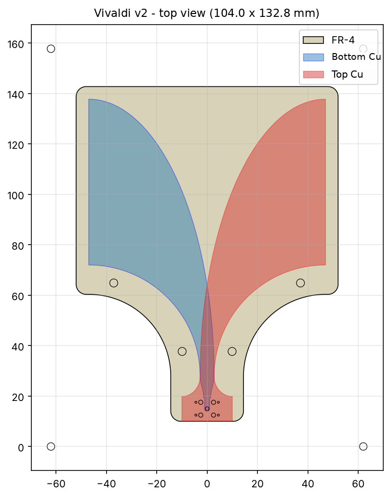
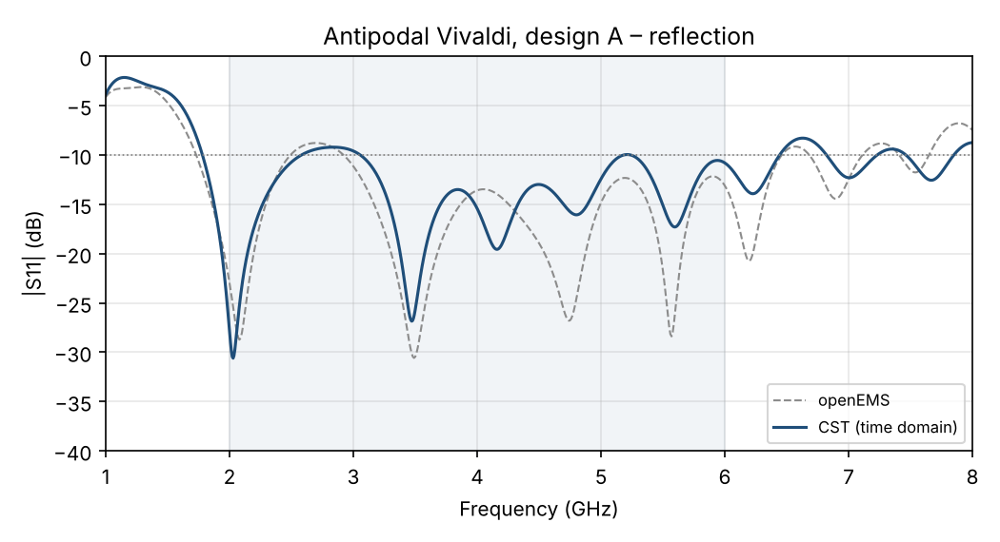
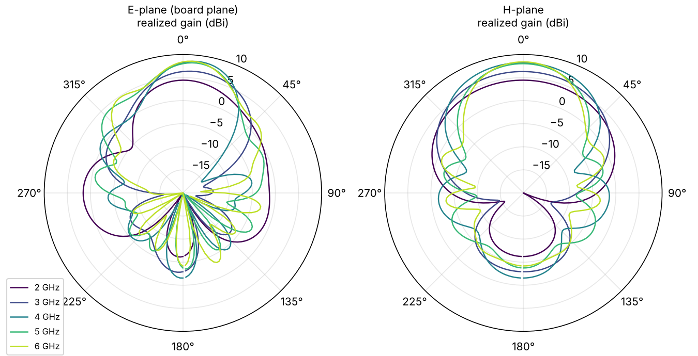
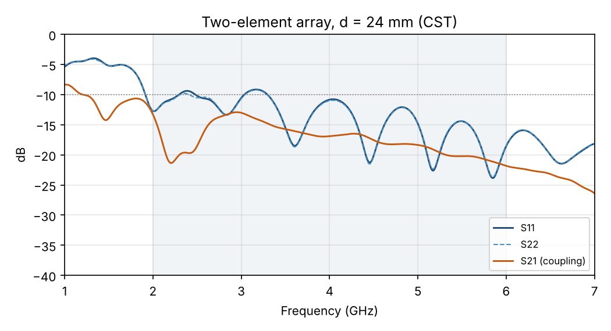

# 2–6 GHz Antipodal Vivaldi and Two-Element Direction-Finding Array

An antipodal Vivaldi antenna on FR-4 that can be milled on a desktop CNC router. Two elements are connected directly to the two receive channels of an AD9361-based SDR (HamGeek E310), and the angle of arrival is estimated from the phase difference between them.



## Results

### Single element

Simulated in CST (time domain, `cst/vivaldi_A.cst`) and cross-checked with openEMS.

| | CST | openEMS |
|---|---|---|
| Worst S11 in 2–6 GHz | −9.2 dB @ 2.83 GHz | −8.8 dB @ 2.70 GHz |
| Max VSWR in 2–6 GHz | 2.06 | 2.14 |
| Share of 2–6 GHz below −10 dB | 87 % | 89 % |

Both solvers place the only weak region at 2.6–3.0 GHz, so it is a property of the design rather than of the solver; outside it the −10 dB band extends from 1.78 to 7.85 GHz.



| Frequency | Realized gain (peak) | Front-to-back | HPBW E / H |
|---|---|---|---|
| 2 GHz | 4.5 dBi | 10.7 dB | 66° / 134° |
| 3 GHz | 6.5 dBi | 9.2 dB | 60° / 104° |
| 4 GHz | 8.7 dBi | 9.8 dB | 40° / 77° |
| 5 GHz | 8.3 dBi | 11.8 dB | 42° / 59° |
| 6 GHz | 8.6 dBi | 12.6 dB | 38° / 50° |

Full table: [`results/cst/performance_table_cst.csv`](results/cst/performance_table_cst.csv). The beam points along the flare (+y); the E-plane is the board plane.



The openEMS study of four shape variants that led to design A is in [`results/v2-variants/`](results/v2-variants/).

### Two-element array (CST)

The array (`cst/dualvivaldi_array.cst`, element spacing 24 mm) was solved in CST with both ports excited in turn. The calibration table [`results/array/vivaldi_array_calibration_H_plane.csv`](results/array/vivaldi_array_calibration_H_plane.csv) gives, for 2–6 GHz in 1° steps, the simulated phase difference, the ideal k·d·sin θ, both port gains and the unambiguous region.

| Frequency | Unambiguous region |
|---|---|
| 2 GHz | ±81° |
| 3 GHz | ±68° |
| 4 GHz | ±65° |
| 5 GHz | ±50° |
| 6 GHz | ±71° |




Mutual coupling between the closely spaced elements (0.16 λ at 2 GHz) makes the simulated phase difference up to about twice the free-space value at low frequencies. The simple k·d·sin θ formula would therefore give large angle errors, so the direction finder should use the simulated (or measured) calibration table.

## Design

| Parameter | Value |
|---|---|
| Substrate | FR-4, 1.6 mm, εr 4.3, tanδ 0.02 |
| Board | 104.0 × 132.8 mm |
| Feed | SMA, pin at (0, 15) mm |
| Design A (selected) | mouth half-width xc = 47 mm, flare length rb = 110 mm |
| Original | xc = 44.43 mm, rb = 88.85 mm |
| Array spacing | 24 mm |
| Fabrication | Linermak LM-R50 C CNC router; DXF layers of design A in `fabrication/Vivaldi_v2_A.zip` |

## Reproducing the results

```
pip install numpy matplotlib
python scripts/vivaldi_v2.py                         # openEMS variants (needs openEMS)
# CST: open cst/vivaldi_A.cst, Start Simulation, export S-parameters as Touchstone
python scripts/vivaldi_calibration.py <ff folder>   # calibration table from CST farfields
```

The array farfields (`ff_<f>GHz_p1/p2.txt`, 10 × 10 MB) are not included; export them from `cst/dualvivaldi_array.cst` (Farfields → ASCII export, 1° steps).

## Limitations

- The matching goal of S11 < −10 dB across 2–6 GHz is missed at 2.6–3.0 GHz (worst −9.2 dB in CST, VSWR 2.06).
- Not yet fabricated or measured.

## Files

| Path | Contents |
|---|---|
| `cst/` | `vivaldi_A.cst` (single element, design A), `dualvivaldi_array.cst` (two-element array), `dualvivaldi.cst` and `vivaldi.cst` (earlier models) |
| `scripts/` | openEMS models (`vivaldi_openems.py` v1, `vivaldi_v2.py` variants), calibration script |
| `openems/` | openEMS geometry |
| `fabrication/` | CNC DXF layers (top, bottom, drills, outline) and preview |
| `figures/` | main plots used in this README |
| `results/` | CST results (`cst/`), two-element array and calibration data (`array/`), openEMS first version (`v1/`) and shape variants (`v2-variants/`) |

## Author

Selim Süleyman Hüthüt, Electrical and Electronics Engineering, Çukurova University

## License

MIT, see [LICENSE](LICENSE).
